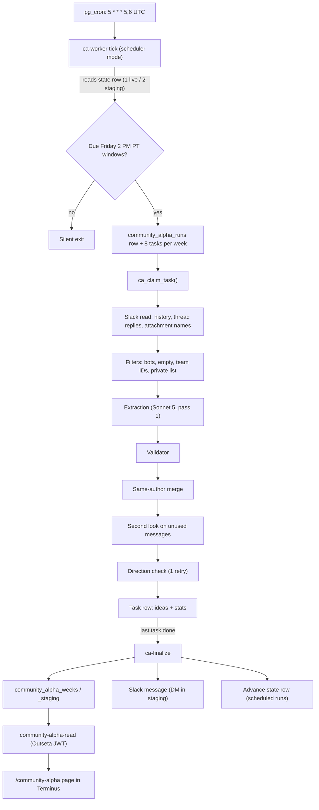

# Community Alpha — Architecture (as of 2026-10-13)

Community Alpha turns one week of Macro Ops community Slack posts into a digest of trade ideas, posts a Slack summary, and shows the digest to members at `/community-alpha` inside Terminus.

No secrets, tokens, or private exclusion list IDs appear in this document.

## 1. Flow



## 2. Components

**Functions**
- `ca-worker` — two roles. As a *tick* (from cron or a manual trigger) it reads the state row for its mode, finds due weekly windows, and creates one run with one task per channel per week. As a *worker* it claims one task at a time, processes it, and calls itself again until no tasks remain, then calls finalize. Requires a private token (checked by hash; the token lives in encrypted Vault).
- `ca-finalize` — merges completed tasks into the weeks table, records tokens and credits on the run, sends the Slack message, and (for scheduled runs) advances the state row. Safe to run twice on the same run.
- `community-alpha-read` — the page's only data source. Verifies the Outseta JWT inside the function, picks the live or staging weeks table, and strips `author_id` and post times from every idea (`shape.ts`).

**Job** — one pg_cron job, `5 * * * 5,6` (UTC): hourly on Fridays and Saturdays UTC. Ticks with nothing due are silent. The first due tick is Friday 2:05 PM PT.

**Tables** (public schema, service-role only RLS)
- `community_alpha_state` — row 1 = live, row 2 = staging; `last_anchor_at` = end of the last processed window.
- `community_alpha_runs` — one per run: mode, trigger (scheduled/manual), anchors (weeks), status, token usage, credits, warnings.
- `community_alpha_tasks` — one per channel per week: status, attempts, ideas, rejected/warning records, stats. `ca_claim_task()` claims atomically and recovers stale tasks. `ca_add_usage()` adds tokens/credits per AI call.
- `community_alpha_weeks` (live) and `community_alpha_weeks_staging` — one row per week: ideas, per-channel status, excluded counts, `source` (`archive` or `job`).

**Page** — `src/pages/CommunityAlpha.tsx` renders inside Terminus's layout (side menu, header). Dashboard logic is a verbatim port of Mike's reference in `src/pages/communityAlphaDashboard.ts`; styling follows Terminus (`src/pages/community-alpha.css`). Features: week list, top tickers, count pills, hide-technical toggle, search across weeks ("/" to focus, Esc to clear), Live/Staging tabs with a "STAGING — test data" banner, phone layout. All data values are escaped; Slack links are clickable only if they start with `https://` and the host ends with `slack.com`.

Shared code: `supabase/functions/_shared/community-alpha/` (`window`, `config`, `slack`, `filters`, `extract`, `validate`, `merge`, `postcheck`, plus tests).

## 3. Weekly pipeline, step by step

1. **Window** (`window.ts`) — weeks run Friday 2 PM PT to the next Friday 2 PM PT (Luxon, America/Los_Angeles, DST-safe; Slack ts compared as integer microseconds). A 1:05 PM PT tick never processes that Friday's window.
2. **Slack read** (`slack.ts`) — channel history for the window plus thread replies; thread parents from before the window are included as `context_only`. Attachments are summarised by type and name/title only (files and link previews); nothing is downloaded.
3. **Filters** (`filters.ts`) — drop bot messages, empty/emoji-only posts, Macro Ops team members (counted as team_excluded), and the private exclusion list. Thread replies are deduped.
4. **Extraction** (`extract.ts`) — Sonnet 5 through Lovable AI Gateway (Messages API, forced tool `record_ideas` with a JSON schema). Messages are sent grouped by thread with author names. Returns ideas plus a tactical-dropped count.
5. **Validator** (`validate.ts`) — checks every field: `message_ts` must be one of the inputs, valid idea type and direction, non-empty tickers, label/one-liner lengths (long one-liners kept with an internal warning), builds the Slack permalink.
6. **Same-author merge** (`postcheck.ts`, `mergeSameAuthor`) — same author + same first instrument (case/space-insensitive) in one channel and week: keep the idea from the latest message; others logged as `same_author_merged`.
7. **Second look** — messages that produced no kept idea are sent back with the same instructions plus the second-look line; other messages in their threads go along as `context_only`. New ideas go through the validator, are deduped against pass 1 (link + tickers), and merged again. If it fails, pass-1 ideas stand (internal `second_look_failed` warning).
8. **Direction check** — one call covers all ideas (both passes). For each idea the AI reports the source author's view (positive/negative/unclear) with a reason and quote; each thread message is marked with its author. Code decides: a mismatch is dropped as `flip_prevented`; "unclear" is kept with a warning; quote mismatches are warning-only. Bad or incomplete answers are retried once; a second failure fails the task with `direction_check_failed`.
9. **Finalize** (`ca-finalize`, `merge.ts`) — per week: skip archive weeks; merge channels (failed channels keep their previous ideas), dedupe by permalink + tickers, cap at 50 ideas (non-#general first, then newest), write with `source = 'job'`, record usage, advance state for scheduled runs. Re-running finalize on the same run creates no duplicates and sends no second message.
10. **Slack message** — the old system's format, linking to the page. Staging: `[STAGING]` prefix, DM to two staging recipients. Link and media previews off. Warning lines for credit cap, direction-check failures, other failures, and the 50-idea cap. "Already up to date" messages are sent only on manual runs.

## 4. Instructions, verbatim

### Extraction instructions (`buildPrompt` in `extract.ts`)
`${channel.name}` is the channel's name. For #general, the line "In this channel, keep ONLY clear ticker + direction calls." is inserted where `${general}` appears.

```text
You extract long-term trade ideas from one week of Macro Ops community Slack messages in channel ${channel.name}. Messages are given as JSON with message_ts, thread_ts, author_id, author_name, posted_at_iso, text, and attachments (a short list of attached files and link previews, for example "image: chart.png" or "link: <page title>"). Thread replies are grouped under the post they answer. Messages marked context_only are there only as background for a thread (for example a thread's first post from before this week); never use them as the source of an idea.

A trade idea is either:
- Ticker + direction: a named instrument (equity, ETF, index, future, FX pair, commodity, country, crypto) plus a direction (long, short, buy, bullish, bearish, calls, puts, adding), or
- A thesis post: a substantive argument for a position, even without price levels.
Look for long-term, high-conviction ideas. New entries and adds to a position count as ideas. Chart-based calls count as ideas too: tag them with technical (below) instead of dropping them. Outside #general, a post that is only a ticker and an attached chart image, with no words about the view, is a bullish technical idea. A PDF, a document, or a link is not a chart. If the text gives any view, follow the text. It's bearish only when the author says the price is likely to fall or that they'd avoid or short it (for example "lower highs", "rolling over", "breaking down", "I'd stay away"). Doubts or questions about a news item are not a bearish call. Judge only what the idea's author wrote. Replies from other people in the thread are context, not the author's view. When the author shares a research note or article as the main content of their own post in an ideas channel, without disagreeing with it, treat its thesis as the author's idea. A view from someone else that the author only mentions in passing, or questions, counts only if the author says they agree with it.${general}

Drop pure tactical position-management updates with no new directional thesis: trims, partial or full profit-taking, stop-outs, "out of all my trades", and any pure exit, cover, or close. Keep substantive bearish-thesis posts even if they mention trimming. A post saying a trade is working and still has room to run is a current idea, not a position update. Also ignore emoji-only messages, GIFs or images with no text, bare links without commentary, questions without a thesis, and generic chatter.

If one author's idea spans several messages, return ONE idea. If the author changes their view on the same instrument during the week, return one idea with their latest view, linked to the message where they state it. If the latest state of that chain is a trim or exit only, return nothing for it. Set message_ts to the message where the ticker or company in the idea is named most explicitly; if several name it, use the earliest. Never pick a message that doesn't mention the ticker or company. message_ts must be one of the message_ts values provided.

In tickers, list every ticker, instrument, or theme the post names for that idea, not only the main one. Write tickers as symbols or short names only, without descriptions in parentheses (6C, not "6C (CAD futures)"). A post that lists several new positions or adds (for example a weekly trades update) is one idea with all of them in tickers. Instruments that share the same view in one post (for example corn, soybeans, soybean meal and soybean oil) are one idea, not several.

Set technical = true when the ONLY stated basis is price action or positioning: chart patterns, breakouts, moving averages, momentum or relative strength, volatility setups, COT/sentiment/crowding, "chart attached", or a technician's read with no other reason. Buying a dip or a pullback is a price-action reason. Set technical = false if the post gives at least one fundamental or macro reason (valuation, earnings, supply/demand, policy, a catalyst, a structural theme), even if a chart is also cited. A description of the business (what the company does, who owns it, a deal, or a company presentation) counts as a fundamental reason. Position updates with no stated basis are false.

Direction precision is critical: never flip long/short, and never label a trim as an entry. Direction is the price move the author expects, not the current positioning. For example, "crowded short, squeeze risk" is bullish, and "managed money very long" on its own is not a short call. Direction always refers to the first instrument in tickers, so list the instrument the post is mainly about first, and describe views on the other instruments in the one-liner. For example, "dollar breaking out, bad for gold" is bullish, with the dollar listed first. For relative views ("prefer A over B", "long A, short B"), list the preferred instrument first; its direction is long or bullish. For options or volatility trades, the instrument is the underlying or its volatility, and the direction is the view on it (selling volatility is bearish on volatility). If you can't tell the direction of an idea, drop that idea.

Return ideas plus tactical_dropped = the number of pure position-management messages you dropped.
```

### Second-look line (appended to the extraction instructions on the second pass)

```text
These messages produced no idea in a first pass. Using the same rules, return only ideas that were missed. Return none if there are none. Messages marked context_only are background and can't be a source.
```

### Direction check rules (`CHECK_PROMPT` in `extract.ts`)

```text
You check trade ideas extracted from Slack posts in the channel named in the input. For each item you get an id, the first instrument, the extracted direction, the label, the idea's author, the one-liner, the source message text and attachments, and the rest of its thread with each message's author (posts marked context_only are background from before the week). For each item, report what the author of the source message thinks about the first instrument. Fill the fields in this order: reason (one short sentence on what the author thinks about the first instrument), author_view ("positive" if they expect it to rise or would buy or be long it, "negative" if they expect it to fall or would short or avoid it, "unclear" otherwise; for volatility instruments, the view is on volatility itself), quote (a short phrase from the source message or its thread that supports the view; "..." is allowed between parts; or "chart only" for a ticker-plus-chart post with no words about the view).

Judge the author's view on the first instrument using these rules. For relative views ("prefer A over B", "long A, short B"), the preferred instrument is positive. For options or volatility trades, judge the view on the underlying or its volatility (selling volatility is negative on volatility). Outside #general, a post that is only a ticker and an attached chart image, with no words about the view, is positive. It's negative only when the author says the price is likely to fall or that they'd avoid or short it (for example "lower highs", "rolling over", "breaking down", "I'd stay away"). Doubts or questions about a news item are not a negative view. Buying a dip or a pullback is positive. Judge only what the idea's author wrote. Replies from other people in the thread are context, not the author's view. When the author shares a research note or article as the main content of their own post in an ideas channel, without disagreeing with it, treat its thesis as the author's idea. A view from someone else that the author only mentions in passing, or questions, counts only if the author says they agree with it. Direction is the price move the author expects, not the current positioning. For example, "crowded short, squeeze risk" is bullish, and "managed money very long" on its own is not a short call.
```

## 5. Safeguards

- **Credit cap** — 3 credits per run, counting every AI call (extraction, second look, direction check, failed and retried calls). Usage is added atomically after each call. When the cap is reached no new AI calls start; the current and all pending tasks fail with `credit_cap`, and the Slack message gets a warning line.
- **Direction check failure** — invalid or incomplete answer: retry once; then the task fails with `direction_check_failed` (no further retries, no pass-through), the channel keeps its previous ideas, and Slack gets a warning line.
- **Other task errors** — retried up to 3 attempts in total, then failed; the channel keeps its previous ideas and Slack names it.
- **Stale tasks** — `ca_claim_task()` re-claims tasks stuck in running.
- **Malformed AI output** — ideas lists and check answers that arrive as text are parsed and rejected if broken.
- **Archive protection** — the 22 imported weeks have `source = 'archive'` and are never reprocessed unless explicitly forced.
- **No duplicate runs** — a tick does not start a run while one for the same mode and trigger is in flight.
- **Staging vs live** — `CA_MODE` picks the state row, weeks table, and message routing. Staging only DMs the two recipients.
- **Privacy** — team and private-list messages are removed before the AI; the read function never returns `author_id` or post times; the private list is a secret and never logged.
- **Page links** — only `https://…slack.com` links are clickable (covers archive weeks).

## 6. Access rules

| Who | Live | Staging |
|---|---|---|
| Collective (includes Turning Point family) | yes | no |
| Team Plan (`7malDMWE`) | yes | yes |
| Anyone else / signed out | no (401/403) | no |

- Enforced in `supabase/functions/community-alpha-read/index.ts` (Outseta JWT verified in-function via `_shared/outseta-jwt.ts`) and `shape.ts` (table choice, field stripping).
- Page gate: `src/lib/outseta/entitlements.ts` (route matrix) and the app's route list.
- Outseta is the source of truth for plans; no Supabase auth is involved.

## 7. Config values and how to change them

| Value | Current | Where | How to change |
|---|---|---|---|
| Channels | #ideas-equities, #ideas-commodities, #ideas-fx, #ideas-rates, #big-bet, #emerging-markets, #general (strict), #hedging | `CA_CHANNELS`, `_shared/community-alpha/config.ts` | Edit, redeploy `ca-worker` and `ca-finalize` |
| Team IDs (excluded) | U6PEHV6RW, U03CSJ4QPFS, U6R43TGFQ, U0AR0DT1BSP, U01CP2H2JDQ, UUSBEJG9K | `CA_TEAM_IDS`, same file | Edit, redeploy `ca-worker` |
| Private exclusion list | (secret) | `CA_PRIVATE_IDS` secret | Update the secret; no code change |
| Slack bot token | (secret) | `CA_SLACK_BOT_TOKEN` secret | Update the secret |
| Schedule | `5 * * * 5,6` UTC; window Fri 2 PM PT | pg_cron job; `window.ts` | Change the cron job via a migration; window logic needs code + tests |
| Mode | staging (live state also exists) | `CA_MODE` secret | Set to `live` to go live |
| Model | `anthropic/claude-sonnet-5` | `CA_MODEL`, `extract.ts` | Edit, redeploy `ca-worker`; update credit rates in `config.ts` |
| Credit cap | 3 per run | `CA_CREDIT_CAP_PER_RUN`, `config.ts` | Edit, redeploy `ca-worker` and `ca-finalize` |
| Idea cap | 50 per week | `CA_MAX_IDEAS_PER_WEEK`, `config.ts` | Edit, redeploy `ca-finalize` |
| Page URL | https://app.foundationmacro.com/community-alpha | `PAGE_URL`, `ca-finalize/index.ts` | Edit, redeploy `ca-finalize` |
| Staging DM recipients | two members | `STAGING_RECIPIENTS`, `ca-finalize/index.ts` | Edit, redeploy `ca-finalize` |
| Instructions | section 4 | `extract.ts` | Edit word for word, redeploy `ca-worker` |

## 8. Typical credits per week

A full 8-channel week with the second look: about **0.9 credits** (week ending Oct 2 re-run: 0.885 total — 0.773 extraction including second look, 0.113 direction check, 17 AI calls). Earlier, before the second look: about 0.7 per week. The second look adds roughly 0.07 credits per channel that has ideas. The 3-credit cap leaves room for a catch-up of about three weeks in one run.

## 9. Known limitations

- **Recall varies run to run.** The same week can return different borderline ideas (for example ChrisM's tax-loss basket appeared in 2 of the last 4 runs). Tuning on Oct 2 is frozen; recall is being measured against Mike's digests over the next real weeks before deciding whether to run extraction twice per channel.
- **Attachments by name only.** Charts, PDFs, and spreadsheets are not read, only their type and name/title.
- **Pending rulings:** bond volatility direction (Mike); SDEV after ChrisM's "this isn't really one of them" reply.
- **Direction check can drop rather than fix** a mis-directed idea (`flip_prevented`).
- **Same-author merge is exact-name based** ("Lumber" and "LBR" are not merged).
- **Read function wording** still says "staff" in its top comment and the "Staging is staff-only" error, though the rule is now Team Plan.
- **Untested:** a real Collective or Team Plan sign-in reading the weeks (only mocked sign-ins and invalid-token refusals were tested).
